# ROYAL HRMS — Architecture Diagrams

Diagrams are written in Mermaid (renders in VS Code, GitHub and the PDF). **Before a client meeting, export them to images or PDF** so they work without internet. Each has *What it shows* and *How to say it*. Everything drawn is verified against source unless marked **(unverified)**; dashed lines mean partial or configuration-dependent.

---

## 1. Overall system architecture

*What it shows:* the three parts of Royal HRMS and the services behind them.

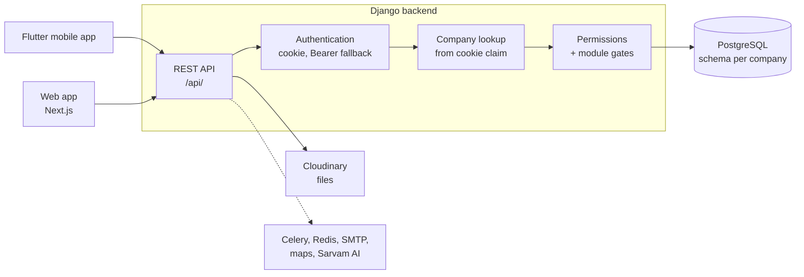

**Say it like this:** "There is one backend. The web app and the mobile app are two front doors to it. Both send the same kind of requests; the backend decides who you are, which company you belong to, and what you may do. Data sits in a PostgreSQL database with a separate, isolated section per company. Files live in Cloudinary."

*Notes:* The company (tenant) is resolved from the **cookie** only; the mobile app relies on its persistent cookie jar (see document 01, section 6.2). The mobile app does **not** use the WebSocket (verified: it polls `/notifications/unread-count/` every 60 s, `notification_providers.dart`). Redis is optional in the backend settings (falls back when `REDIS_URL` is unset). Whether the production server runs Redis/Celery workers, and what its hosting looks like, is **unverified** from source — do not describe production infrastructure to the client.

---

## 2. Flutter feature architecture (layers)

*What it shows:* how one feature folder is organised and which layer may call which.

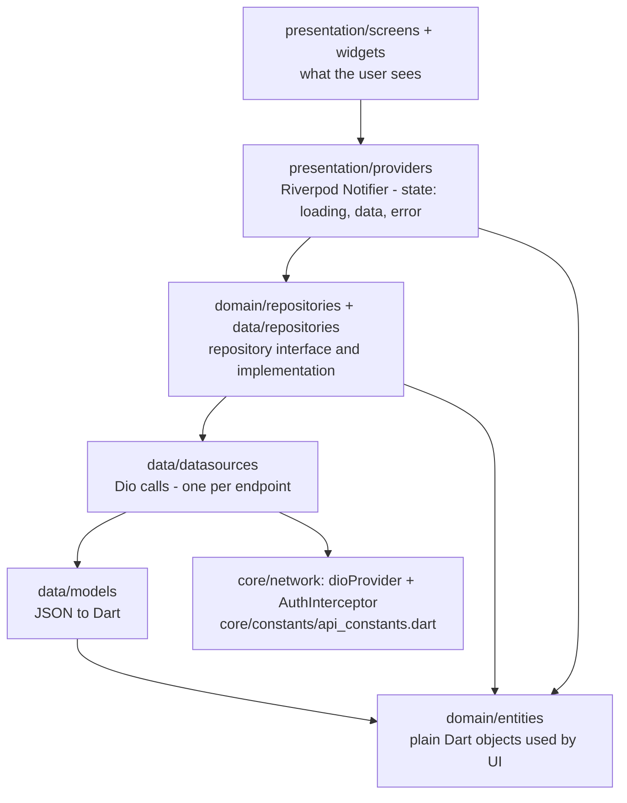

**Say it like this:** "Each feature follows the same layers. The screen only draws things. A provider holds the state. A repository hides where the data comes from. A data source makes the actual web request. If the API changes, we change one layer, not every screen."

*Note:* the layering is the project's convention; not every small feature has all folders (e.g. `training` has `data` + `presentation` only; some providers call the data source directly). That is verified by the folder listing.

---

## 3. Folder structure

*What it shows:* the meaningful parts of `mobile_app/`.

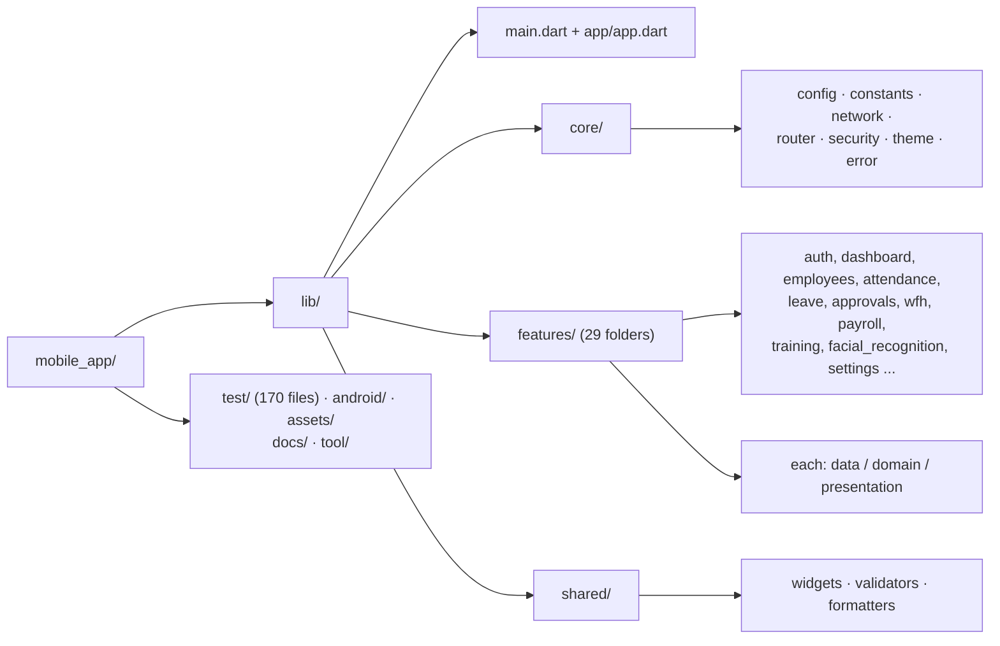

**Say it like this:** "`core` is the foundation everyone shares: networking, routing, security, theme. `features` has one folder per business area. `shared` has small reusable pieces such as buttons and error screens."

---

## 4. Application startup

*What it shows:* what happens from the icon tap to the first usable screen.

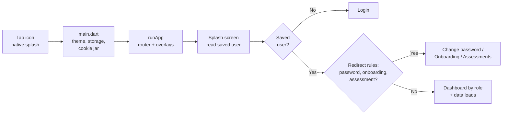

**Say it like this:** "The app prepares theme and storage, then shows a short splash while it checks whether you are already signed in. If not, you see Login. If yes, a set of rules sends you to the right place. Permissions are checked at this point."

*Note:* the splash always shows for at least 1.8 s (`splash_screen.dart`, `_resolveSession`). Startup restores the **cached** user; the session is validated by the first API call (silent refresh on 401).

---

## 5. Login sequence

*What it shows:* who talks to whom during sign-in.

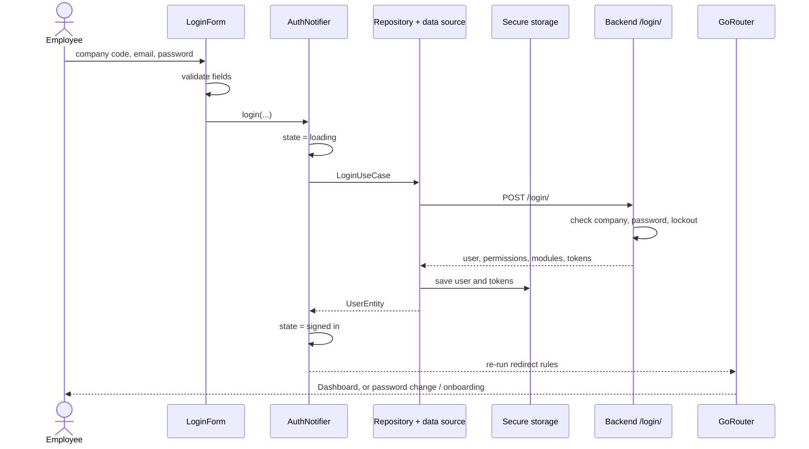

**Say it like this:** "You type your company code, email and password. The app validates the form, sends one request, and the server answers with who you are and what you may do. We save that securely on the phone and the router takes you to the right screen. Wrong credentials give a generic message — the server never reveals which part was wrong."

---

## 6. API request / response lifecycle

*What it shows:* the path of any API call, including silent token refresh.

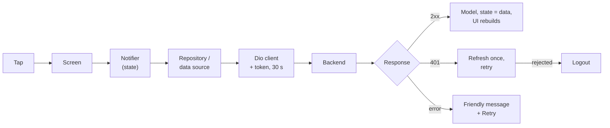

**Say it like this:** "A tap becomes a request, travels through one shared client that attaches your token, and returns. Success updates the screen. If the token expired, the app refreshes it quietly and retries. Any other failure becomes a friendly message with a Retry button."

---

## 7. Attendance and Face ID flow

*What it shows:* the clock-in recipe (`runClockPunch`) and where verification happens.

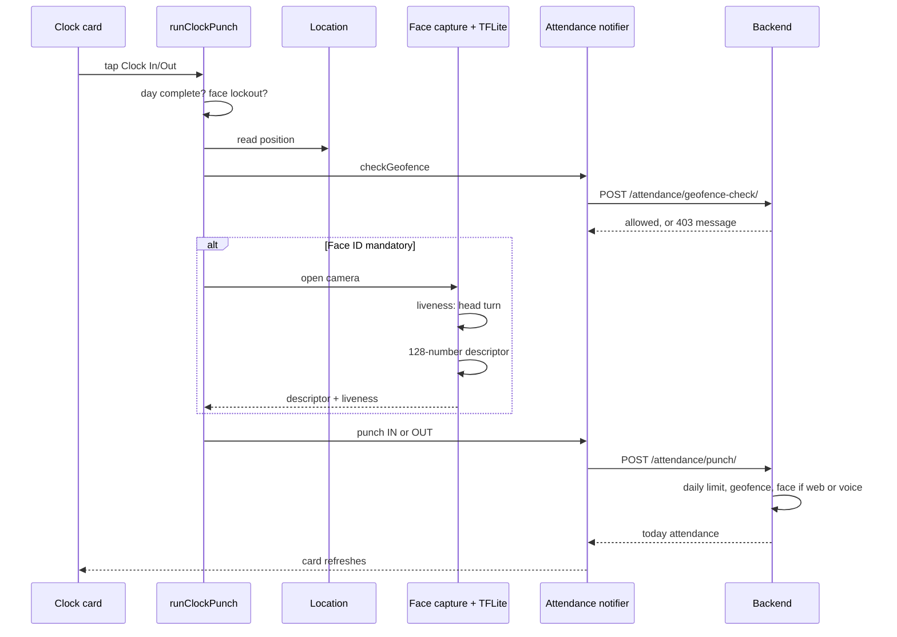

**Say it like this:** "Clock-in is a short checklist: is the day already done, where are you, are you inside the allowed area, and — if the company requires it — does your face match. The face is turned into 128 numbers on your phone; no photo is sent. The server then records the punch."

**Open issue (HO-01, P0, open):** server-side face matching applies only to `web` and `voice` punches. The client chooses `source`, and mobile sends `mobile`, so matching is skipped; the mobile face check is app-side only. Geofence **is** enforced server-side. This flow has never run on a physical device (FACE-06/07/08).

---

## 8. Leave request and approval flow

*What it shows:* from the apply form to the approval status.

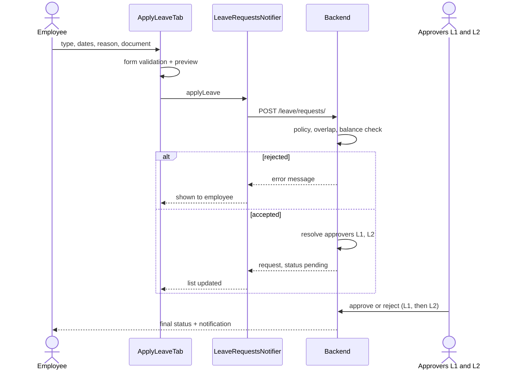

**Say it like this:** "The employee fills the form. The server checks the company's leave policy — notice period, overlaps, balance — and if everything is fine creates a pending request and assigns approvers. Managers approve in the Approvals screen. The employee sees the status change."

---

## 9. Database relationships (1 of 3): people, access and branches

*What it shows:* only verified relationships. Field lists are abbreviated.

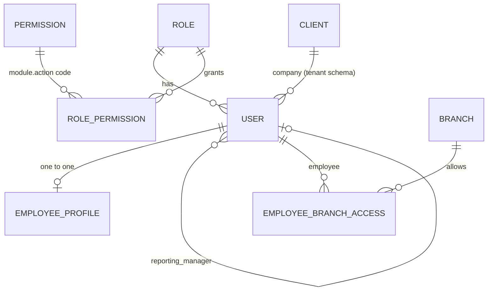

## 9. Database relationships (2 of 3): attendance and leave

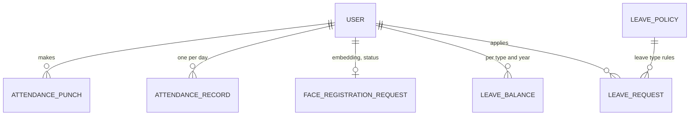

## 9. Database relationships (3 of 3): delegation and training

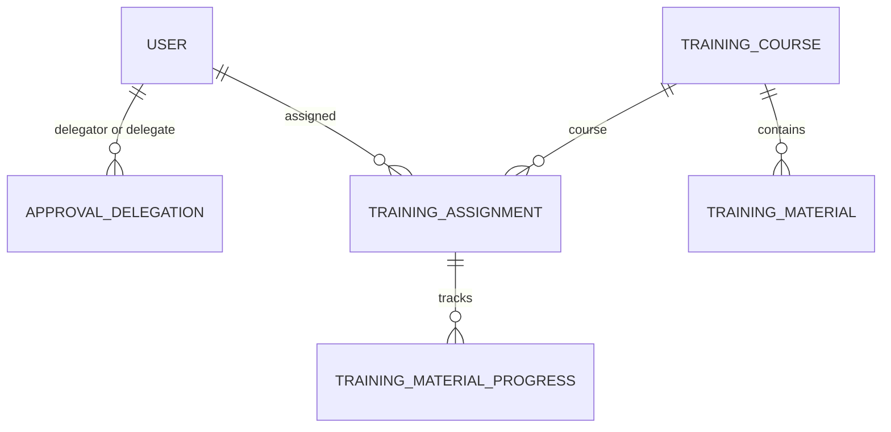

**Say it like this:** "Each company gets its own isolated database section. Inside, a User belongs to a Role, and a Role is a bundle of permissions (part 1). Attendance, leave (part 2), delegation and training (part 3) all hang off the user. Leave requests carry level-1 and level-2 approvers (`l1_approver`, `l2_approver` on the request; not drawn)."

**Important accuracy notes (verified):**
- `User.branch`, `User.department`, `User.designation` are **text fields**, not foreign keys (`apps/accounts/models.py`). `Branch` is a separate model reached through `EmployeeBranchAccess`.
- There is **no generic "ApprovalRequest" table**. Approval state is stored on each request (leave, WFH, etc.); `ApprovalDelegation` and escalation settings live in `apps/approvals`.
- There is no `Enrollment` model (`TrainingAssignment` plays that role). `Company` (`apps/accounts`) is a per-tenant profile record; the tenant itself is `tenants.Client`.

---

## 10. Build and deployment flow

*What it shows:* how source becomes a Play Store release.

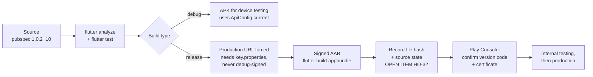

**Say it like this:** "We test first. A release build always talks to the production server and always needs the company's upload key — it cannot be accidentally signed with a test key. Before uploading we record exactly which source produced the file. That last step is still an open item."
